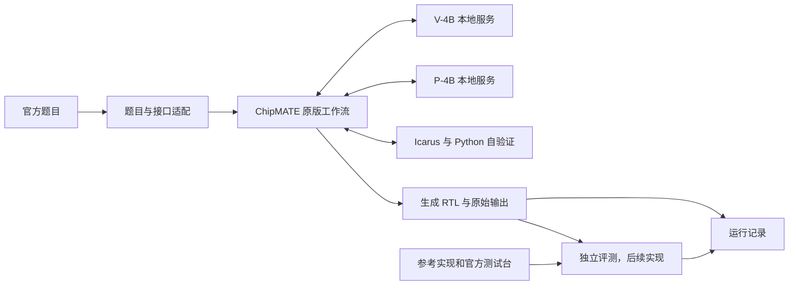

# 仓库架构

采用独立比赛工程，固定版本保留 ChipMATE。三份核心文档维护当前共识；
逐次历史记录放在 journal/。当前状态和资源见 [context.md](context.md)，阶段边界见
[decisions.md](decisions.md)。

## 目录与文件职责

```text
qiansai/
├── README.md
├── AGENTS.md
├── docs/
│   ├── context.md
│   ├── decisions.md
│   ├── architecture.md
│   ├── journal/
│   │   ├── _template.md
│   │   └── YYYYMMDD_HHMMSS_keyword.md
│   └── references/amd_2026_guide.pdf
├── third_party/chipmate/             # 固定提交的上游子模块
├── src/qiansai/
│   ├── __init__.py
│   ├── runner.py                     # 配置适配与原版调用入口
│   ├── baseline.py                   # 同模型单次直接生成入口
│   ├── datasets.py                   # 题目和接口声明转换
│   └── evaluation.py                 # 独立评测边界，目前预留
├── configs/
│   ├── chipmate_4b.yaml
│   └── serving.yaml
├── docker/
│   ├── Dockerfile.cuda               # 待实机验证的 CUDA 模板
│   ├── compose.cuda.yaml
│   ├── entrypoint.sh
│   └── README.md                     # ROCm 文件在迁移阶段添加
├── model/
│   ├── MODEL.md
│   ├── manifest.json
│   └── weights/
├── data/
│   ├── verilog_eval/                 # 官方数据与评测器子模块
│   └── processed/
├── scripts/
│   ├── fetch_models.py
│   ├── prepare_data.py
│   ├── run_batch.sh
│   └── smoke_test.sh
├── tests/
├── skill/
├── runs/
├── run.sh
├── run_baseline.sh
├── pyproject.toml
├── uv.lock
├── .env.example
├── .gitmodules
├── .gitignore
└── .dockerignore
```

源码目录当前只有轻量入口和数据准备能力。独立评分、完整运行追踪和改进策略在相应阶段
实现；不以空的成功结果替代尚未完成的功能。ROCm Dockerfile、Compose 配置和 Vivado
适配只登记边界，实施时再创建，避免不可用模板被误认为完成状态。

## 数据流



上游 ref_sv 参数只用于读取接口。我们的转换器仅输出 module 声明和 endmodule，
不把参考逻辑正文打包到生成输入中。评测器访问独立的参考实现和测试台。
完整工作流通过率必须来自独立评测，自验证一致性另列。

## Docker 与迁移

首阶段单容器：

- vLLM 服务 V：本地端口 8001。
- vLLM 服务 P：本地端口 8002。
- ChipMATE / qiansai / Icarus：通过本地服务接口生成与验证。
- 两个推理进程共享同一张被授权映射的 GPU；共同核算显存与并发。
- entrypoint 负责子进程启动、健康等待、异常退出和退出时回收。

镜像固定 GPU 推理依赖；uv.lock 固定独立的工作流 Python 环境，避免随意改变镜像内
vLLM 的依赖。开发时挂载源码，权重只读挂载，runs/ 可写挂载。
容器移除不删除宿主机的实验文件。

迁移 AMD 时增加 Dockerfile.rocm 与 compose.rocm.yaml，配置设备、ROCm/vLLM
版本及相应的算子和运行参数。业务层继续使用相同模型服务接口。
分别记录 W7900 与最终 R9700 的实测覆盖，不能用其中一次测试推定另一平台已通过。
GPU 驱动由宿主机提供，镜像本身不能保证硬件兼容性。

官方基础镜像发布后，将相同启动、生成和基线入口整合进基于它构建的离线容器。
开发入口协议不提前冒充官方协议。

## 日志、产物与版本

每次工作生成 docs/journal/ 下的新日志。每次实验生成独立目录：

```text
runs/YYYYMMDD_HHMMSS_keyword/
├── manifest.json             # 命令、时间、代码/数据/权重/镜像版本
├── config.yaml               # 实际配置快照
├── inputs.jsonl
├── outputs.jsonl
├── metrics.json              # 有独立评测后才填写正确率
├── logs/
└── tasks/
```

这是运行记录契约，当前上游 CLI 只产生它本身已有的输出与控制台日志。
完整模型调用追踪和自动生成所有清单是云端部署阶段的实现项。

Git 保存文档、代码、配置、脚本、轻量可分享结果以及上游 gitlink。权重、生成数据、
虚拟环境和大型运行产物独立持久保存。Git clone 只恢复版本化内容；完整实验历史需要
同步相应产物存储。历史记录默认不覆盖、不清理。
