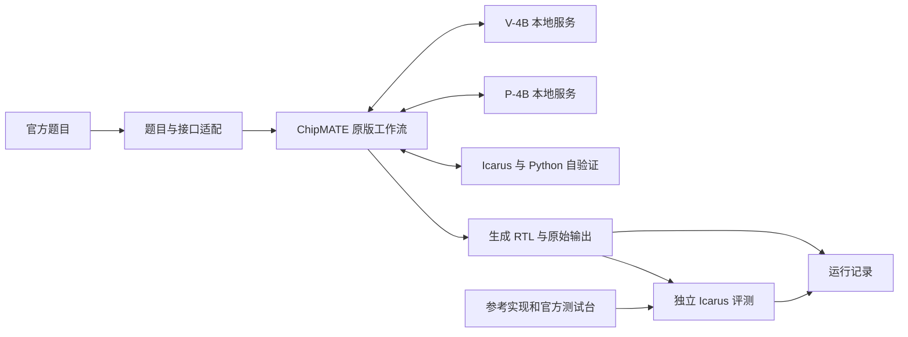

# 仓库架构

采用独立比赛工程，固定版本保留 ChipMATE。三份核心文档维护当前共识；
逐次历史记录放在 journal/。当前状态和资源见 [context.md](context.md)，阶段边界见
[decisions.md](decisions.md)。

## 本地与服务器的实际分工

两端使用同一份 Git 工程，分别准备本机运行环境。以下为 2026-09-11 的实际部署位置，
不是脚本必须硬编码的路径。

| 内容 | 本地开发端 | NVIDIA 执行端 | Git 与新服务器恢复方式 |
| --- | --- | --- | --- |
| 工程根目录 | /home/young/autodl/qiansai | /root/autodl-tmp/qiansai | 在新机器选择持久化目录 clone |
| 主要职责 | 开发、pytest、文档、Git、查看与归档结果 | 下载权重、安装 GPU 依赖、推理、交叉验证、官方独立评测 | 代码、配置、文档与脚本由 Git 恢复 |
| 上游代码与原始题目 | 已有 | 已有 | --recurse-submodules 获取固定 ChipMATE 和 156 题数据 |
| 处理后题目 | data/processed 已生成 | data/processed 已生成 | 不入 Git，安装脚本重新生成 |
| 工作流环境 | .venv，轻量项目依赖 | .venv，轻量项目依赖 | 不复制已安装环境，按 uv.lock 重建 |
| GPU 环境 | 未安装项目 GPU 环境 | .venv-vllm 链接到 /root/qiansai-envs/vllm-0.19.1 | 按 docker/requirements.cuda.lock 重建 |
| 模型权重 | model/weights 仅保留占位文件 | model/weights/chipmate-v-4b 与 chipmate-p-4b，固定版本及校验清单 | Git 仅保存身份；完整目录另行复制或授权下载 |
| 实验产物 | runs/ 保存已同步的完整实验与对照结果 | runs/ 是任务执行时产生原始结果的位置 | 完整产物不入 Git；恢复历史时另行复制，新实验不依赖旧结果 |

业务代码、文档、配置、依赖锁、模型身份和子模块版本进入 GitHub 仓库。
本次实际同步方法为本地 push GitHub，并通过 SSH 传递 Git bundle 让服务器快进到同一提交；
原始 runs/ 用 rsync 单独同步。Git 不负责复制 Python 环境、模型权重、缓存和大型产物。
两端 .venv 按相同依赖约定分别安装，不直接复制虚拟环境。

一次 testcase 的工作流、两个模型服务和 Icarus 评测均在服务器完成，HTTP 请求使用
服务器自身的 127.0.0.1:8001/8002。本地 SSH 负责发起和查看任务。
本次全量任务用 nohup 在服务器后台运行，控制脚本保存日志与退出码；
直接执行 run.sh 本身仍是前台命令，长任务是否脱离 SSH 由启动方式决定。

当前实际部署为 AutoDL 平台容器加上述两个 Python 环境。GPU 环境在系统盘的独立目录，
项目、权重和结果位于数据盘。仓库自有 Dockerfile/Compose 仍待构建验证。
详细复核见 [两端架构说明记录](journal/20260911_211722_architecture_review.md)。

## 目录与文件职责

```text
qiansai/
├── README.md
├── AGENTS.md
├── docs/
│   ├── context.md
│   ├── decisions.md
│   ├── architecture.md
│   ├── competition.md               # AMD 3.1 规则专题与当前结果差距
│   ├── guides/server_setup.md        # 两端文件清单与新 NVIDIA 服务器部署步骤
│   ├── journal/
│   │   ├── _template.md
│   │   └── YYYYMMDD_HHMMSS_keyword.md
│   └── references/amd_2026_guide.pdf
├── third_party/chipmate/             # 固定提交的上游子模块
├── src/qiansai/
│   ├── __init__.py
│   ├── runner.py                     # 配置适配与原版调用入口
│   ├── case_runner.py                # 题号选择、原版调用、追踪与结果汇总
│   ├── services.py                   # HTTP 就绪检查及本次推理进程管理
│   ├── baseline.py                   # 同模型单次直接生成入口
│   ├── datasets.py                   # 题目和接口声明转换
│   └── evaluation.py                 # 官方参考与测试台的独立 Icarus 评测
├── configs/
│   ├── chipmate_4b.yaml
│   └── serving.yaml
├── docker/
│   ├── Dockerfile.cuda               # 待实机验证的 CUDA 模板
│   ├── compose.cuda.yaml
│   ├── entrypoint.sh
│   ├── requirements.cuda.txt         # 独立 GPU 环境的版本约束
│   ├── requirements.cuda.lock        # 已解析的完整版本与哈希
│   └── README.md                     # ROCm 文件在迁移阶段添加
├── model/
│   ├── MODEL.md
│   ├── manifest.json
│   └── weights/
├── data/
│   ├── verilog_eval/                 # 官方数据与评测器子模块
│   └── processed/
├── scripts/
│   ├── fetch_models.py
│   ├── prepare_data.py
│   ├── run_batch.sh
│   ├── setup_cuda.sh
│   ├── serve_models.sh
│   └── smoke_test.sh
├── tests/
├── skill/
├── runs/
├── run.sh
├── run_baseline.sh
├── pyproject.toml
├── uv.lock
├── .env.example
├── .gitmodules
├── .gitignore
└── .dockerignore
```

源码实现题号/套件入口、原版工作流追踪、服务管理和独立功能评测。
ROCm Dockerfile、Compose 配置和 Vivado 适配仍只登记边界，实施时再创建。
测试中的固定 HTTP 响应仅用于 CPU 集成验证，不能代表真实模型结果。

## 数据流



上游 ref_sv 参数只用于读取接口。我们的转换器仅输出 module 声明和 endmodule，
不把参考逻辑正文打包到生成输入中。评测器访问独立的参考实现和测试台。
完整工作流通过率必须来自独立评测，自验证一致性另列。

case_runner 直接调用固定版本 chipmate.inference.run_problem，包装 backend.generate
保存每批提示词与候选文本；不改变上游提示词、候选配对、反馈、采样或停止规则。
SDK 内部重试仍由上游负责，当前追踪不是逐次 HTTP 请求录制。
官方参考正文和测试台只传给 evaluate，不传给两个模型。

evaluate 使用 Icarus 编译候选、参考和官方测试台，要求仿真正常退出、没有超时标志、
恰好一个官方汇总、样本数大于零且没有不匹配。编译失败时仿真为 NOT_RUN。
工具超时后终止其进程组，保存编译和仿真的原始日志。
此处是独立功能检查；Vivado 综合、赛事最终评分和论文 pass@k 复现尚未接入。

## Docker 与迁移

首阶段单容器：

- vLLM 服务 V：本地端口 8001。
- vLLM 服务 P：本地端口 8002。
- ChipMATE / qiansai / Icarus：通过本地服务接口生成与验证。
- 两个推理进程共享同一张被授权映射的 GPU；共同核算显存与并发。
- entrypoint 与宿主机入口共用 services.py，负责子进程启动、健康等待、异常退出和回收。

services.py 只通过 HTTP 与外部 vLLM 可执行程序交互，不导入 GPU 库。
工作流 .venv 与 GPU .venv-vllm 分开；后者可用链接指向服务器其他磁盘上的专用环境。
入口自动前置工作流的 bin 路径，vLLM 子进程使用其独立环境的 bin；无需手工激活 Conda/venv。
推理入口将本机地址加入 NO_PROXY，让下载代理与本地模型 HTTP 调用共存。
两个服务依次启动并完成健康检查，再继续下一服务；核验 /health 和 /v1/models。
已有且模型名称匹配的服务可以复用；这种复用只检查服务接口，不构成运行权重的远程证明。
命令退出时只回收本次启动的进程组，已有服务保持其原有生命周期。

镜像固定 GPU 推理依赖；uv.lock 固定独立的工作流 Python 环境，避免随意改变镜像内
vLLM 的依赖。开发时挂载源码，权重只读挂载，runs/ 可写挂载。
容器移除不删除宿主机的实验文件。

当前 AutoDL 资源本身是容器，未提供 Docker 命令/socket。
依赖安装和模型下载直接在该服务器后台运行，保存独立日志、PID、退出码；SSH 断开不结束任务。
项目与权重位于服务器数据盘，GPU 环境单独放置，避免系统盘承载全部大文件。
自有 Dockerfile 和 Compose 尚未构建验证，不能把平台容器运行视为自有镜像已验证。

### 从 Git 准备新 NVIDIA 服务器

逐步操作手册见 [本地文件与新服务器部署](guides/server_setup.md)。

新服务器需先具备仓库访问权限、可用的 NVIDIA 驱动、Python 3.12、uv 0.9.18、
Icarus Verilog/vvp 和编译工具。现有安装脚本不会替代这些基础准备。
下列命令展示当前已有入口，不代表新服务器或 A100 已经实际验收：

```bash
git clone --recurse-submodules https://github.com/fusang991/qiansai.git
cd qiansai
bash scripts/setup_cuda.sh
.venv/bin/hf auth login
.venv/bin/python scripts/fetch_models.py
./run.sh --case Prob001_zero --case Prob007_wire --case Prob034_dff8
./run.sh --suite verilogeval-v2
```

setup_cuda.sh 创建两套 Python 环境、安装锁定依赖、转换题目并调用 pytest。
HF 登录需要已有两份模型的访问权限；也可复制旧服务器整个 model/weights/ 并校验，
替代登录和下载步骤。完整复制包括权重、配置、分词器与下载校验清单。
Git clone 不恢复 Python 环境、模型文件或完整历史；新 testcase 不依赖旧 runs/。
逐项核对与问答见 [Git clone 恢复说明](journal/20260911_220716_clone_recovery.md)。

### A100 迁移与关机边界

2026-09-11 核对的部署边界：普通项目目录副本不包含系统盘上的 GPU 环境链接目标；
AutoDL 私有系统镜像不包含数据盘上的项目、权重和结果。因此迁移或独立备份应同时覆盖
系统环境与数据。代码/依赖锁/模型清单提供重建依据，不能代替实际权重和原始实验副本。

A100 仍使用 CUDA，预计可复用业务入口，尚未实际验收。AutoDL 同地区迁移可在关机后
克隆实例并勾选复制数据盘；跨平台按锁定版本重建两个 Python 环境，核验权重后运行
pytest、少量真实题目和完整套件。不要同时改变算法、模型和依赖版本。
当前服务各占 0.45 显存比例；新卡总显存不同，需要重算分配并实测 32 GB 约束。
复制数据盘后须检查 .venv-vllm 链接目标，不能假定原系统盘环境随目录一起到达。

普通关机结束进程和内存状态，磁盘按平台保留规则保留；nohup 只解决 SSH 断开。
当前运行入口没有自动断点续跑。AutoDL 官方当日说明连续关机 15 天会自动释放实例，
释放会清除系统盘和数据盘；按量关机不保留 GPU 名额，计费与保留期限以控制台为准。
短期暂停可正常关机，长期停用或释放前先核验私有系统镜像和独立数据副本。

本次只核对并记录建议，没有关机、释放、创建实例或制作备份。
全量实验、控制日志和参考实现对照已逐文件散列，与本地副本聚合摘要一致；
权重和 GPU 环境尚未由我们制作独立备份。来源、限制和原始证据见
[A100 迁移与关机评估](journal/20260911_213632_a100_shutdown_review.md)。

### AMD 与赛事镜像

迁移 AMD 时增加 Dockerfile.rocm 与 compose.rocm.yaml，配置设备、ROCm/vLLM
版本及相应的算子和运行参数。业务层继续使用相同模型服务接口。
分别记录 W7900 与最终 R9700 的实测覆盖，不能用其中一次测试推定另一平台已通过。
GPU 驱动由宿主机提供，镜像本身不能保证硬件兼容性。

官方基础镜像发布后，将相同启动、生成和基线入口整合进基于它构建的离线容器。
开发入口协议不提前冒充官方协议。

## 日志、产物与版本

每次工作生成 docs/journal/ 下的新日志。每次实验生成独立目录：

```text
runs/YYYYMMDD_HHMMSS_keyword/
├── manifest.json             # 命令、时间、代码/数据/权重/镜像版本
├── config.yaml               # 实际配置快照
├── services.json             # 启动/复用情况、命令与启动时间
├── inputs.jsonl
├── outputs.jsonl
├── metrics.json              # 有独立评测后才填写正确率
├── logs/
└── tasks/
```

--case/--suite 已实现以上运行目录；services.json 在双服务准备成功后写入。
manifest 记录代码提交、工作区状态、自有代码哈希、上游/数据版本和配置中的模型身份。
同时保存已下载文件的 revision 与 SHA256 清单；首次 NVIDIA 验收还在独立控制目录保存每秒显存 CSV。
metrics 保存总耗时、各题结果与生成耗时，不把自验证一致率合并为独立通过率。
每题 tasks/<task_id>/ 包含 generation.json、TopModule.sv、reference_model.py、
calls/<role>/batch_XX/request.json 与 response.json，以及 evaluation/ 的完整输入和日志。
--input/--out 兼容入口仍直接调用上游 CLI，只保存上游原始输出。

Git 保存文档、代码、配置、脚本、轻量可分享结果以及上游 gitlink。权重、生成数据、
虚拟环境和大型运行产物独立持久保存。Git clone 只恢复版本化内容；完整实验历史需要
同步相应产物存储。历史记录默认不覆盖、不清理。

首轮真实证据位于 runs/20260911_134142_nvidia_acceptance/ 及对应的 _control/ 目录，
已同步本地和服务器；轻量结果写入 journal，完整产物仍按上述边界独立保存。

初版全量证据位于 runs/20260911_140804_nvidia_full_suite/ 及对应的 _control/；
汇总与逐题表位于 runs/20260911_140717_full_suite_session/。
CPU 参考实现对照独立保存于 runs/20260911_193510_evaluator_reference_control/，
只将固定参考模块重命名为候选模块，检查同一服务器和评测器的适用性，不调用模型。
对照异常作为结果解释附加到报告，不改写原始模型输出、得分或子模块。
