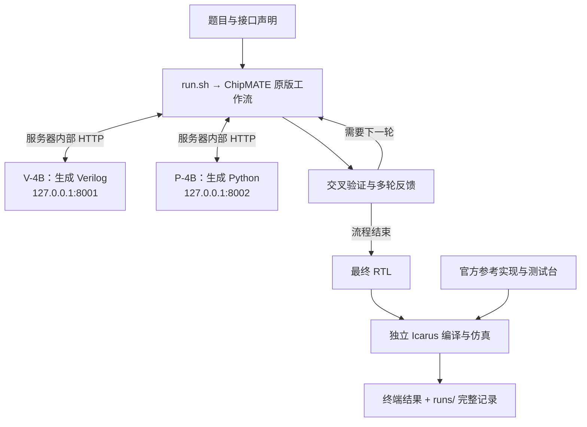

# 2026-09-11 21:17:22 + architecture_review

- 时区：Asia/Shanghai；本次说明与只读复核。
- 起始版本：4e7e3be1eb0e151e011773b324fa6db9be758717。
- 关联：[全量运行结果](20260911_193029_full_suite_results.md)、[当前架构](../architecture.md)。

## 用户原始输入

> 所以现在整个本地和 服务器端的架构是怎么样的

## 助手用户可见回复

> 我先核对本地和服务器当前的目录、运行环境与版本，再把两端各自负责什么、数据放在哪里讲清楚。

> 已核对：两端代码版本一致。实际运行采用服务器上的两个独立 Python 环境；权重只在服务器，完整测试结果已同步回本地。我会把这份两端职责说明补进架构文档。

## 操作、证据与边界

- 读取 README、三份共识文档、AGENTS、近期结果日志、配置、Docker 说明及前轮 publication.json。
- git status --short 为空；本地 HEAD 为 4e7e3be。
- 使用 rg --files 查看工程目录。首次 ls 同时检查本地 .venv-vllm，因该路径不存在返回 2，
  同一 && 链中的日期命令未执行；改用 Python 显式判断存在性并另行读取实际时间。
- 21:17:22 本地检查：.venv 存在，.venv-vllm 不存在，model/weights 仅有 .gitkeep；
  data/processed 与 runs 存在。
- 旧 SSH 复用连接失效，BatchMode 返回 Permission denied；用已有授权重新建立连接后恢复。
  不记录密码、token 或认证 URL。
- 21:18:11 服务器检查：HEAD 同为 4e7e3be，工作区干净；
  .venv-vllm 实际链接到 /root/qiansai-envs/vllm-0.19.1，工作流 .venv 独立。
- 服务器模型身份仍为 V revision 7fbb17249a49d109787bbc024a7a21b83302a1c2、
  P revision cf59695163ad3e4b63bcc6c4eaa91b05fedc4a2e。
- 服务器 GPU 为 RTX 4080 SUPER，32760 MiB，当前 1 MiB / 0%；
  /.dockerenv 存在，Docker 命令与 socket 均不可用。
- 本次只解释现有架构并补充 docs/architecture.md 中的两端分工、存储位置、同步方式与前后台运行边界。
  不修改代码、依赖、模型、数据或服务，不重复模型推理或 pytest；Docker/AMD/Vivado 状态保持未验收。
- Git 管理源码、配置、文档、轻量证据与子模块固定版本；权重、环境、缓存与完整产物单独管理。
  实际代码同步使用已提交 Git bundle 和服务器快进，结果使用 rsync，不将虚拟环境从本地复制到服务器。
- 普通 run.sh 是前台命令；此前全量任务由 nohup 后台控制脚本启动。这两个事实分别说明。
- 本次文档提交可从包含本日志的 Git 历史追溯；发布后核对本地、GitHub 与服务器版本一致。

## 面向用户的完整说明

以下答复按本次实际复核编写：

现在是：**本地负责开发和管理，服务器负责模型推理与评测，两端共用同一份 Git 工程。**

| 内容 | 本地 | 服务器 |
|---|---|---|
| 工程位置 | `/home/young/autodl/qiansai` | `/root/autodl-tmp/qiansai` |
| 主要职责 | 写代码、文档、pytest、Git、查看结果 | 下载权重、安装 GPU 依赖、运行全部 testcase |
| 工作流环境 | `.venv` | `.venv` |
| GPU 环境 | 未安装项目 GPU 环境 | `.venv-vllm`，独立安装 vLLM、PyTorch、CUDA 依赖 |
| 模型权重 | 只有目录占位 | 两份完整 4B 权重 |
| 实验记录 | 已同步的结果副本 | 运行产生的原始结果 |

服务器的 `.venv-vllm` 实际链接到 `/root/qiansai-envs/vllm-0.19.1`。项目、权重和结果放在服务器数据盘。

两端共用的工程目录如下：

```text
qiansai/
├── README.md / AGENTS.md       # 使用说明与协作规则
├── docs/
│   ├── context.md             # 术语、背景、当前事实
│   ├── decisions.md           # 共识、阶段目标与取舍
│   ├── architecture.md        # 架构、接口与部署边界
│   └── journal/               # 每次工作记录
├── src/qiansai/               # 我们自己的工程代码
│   ├── case_runner.py         # 选题、调用上游、记录与汇总
│   ├── services.py            # 模型服务启动、复用、回收
│   ├── datasets.py            # 题目和接口适配
│   ├── evaluation.py          # 官方独立评测
│   ├── runner.py              # 命令入口
│   └── baseline.py            # 单模型基线入口
├── third_party/chipmate/      # 固定版本的原版算法
├── configs/                   # 工作流参数与模型服务参数
├── docker/                    # GPU 依赖锁、容器部署模板
├── model/
│   ├── manifest.json          # 权重版本、哈希和验证记录
│   └── weights/               # 服务器上的实际权重
├── data/
│   ├── verilog_eval/          # 固定版本的官方数据与测试台
│   └── processed/             # 处理后的题目与接口
├── scripts/                   # 安装、下载、准备数据、检查
├── tests/                     # pytest
├── skill/                     # 后续扩展预留
├── runs/                      # 每次实验的独立产物目录
├── run.sh                     # 双模型 testcase 入口
├── run_baseline.sh            # 单模型基线入口
└── pyproject.toml / uv.lock   # 工作流依赖
```

在服务器执行 `./run.sh --case Prob001_zero` 时，流程是：



**两个模型共享同一张 32 GB GPU。** 整个生成、交叉验证和评测都在服务器完成。本地通过 SSH 发起和查看任务；本次全量运行采用服务器后台任务，因此断开会话后仍能继续。

代码和文档提交到 GitHub，服务器按 Git 提交同步；本次使用 Git bundle 传输版本。原始结果通过 rsync 传回本地。权重、虚拟环境、缓存和大型运行产物独立保存，Git 记录它们的版本身份与关键结果。

**当前实际部署是“AutoDL 平台容器 + 两个 Python 环境”。** 自有 Dockerfile、Compose 已准备，尚未构建验收。后续 AMD 适配主要落在 GPU 推理环境和服务配置，复用现有工作流、数据和评测接口。

这份说明已补入[架构文档](../architecture.md)。
